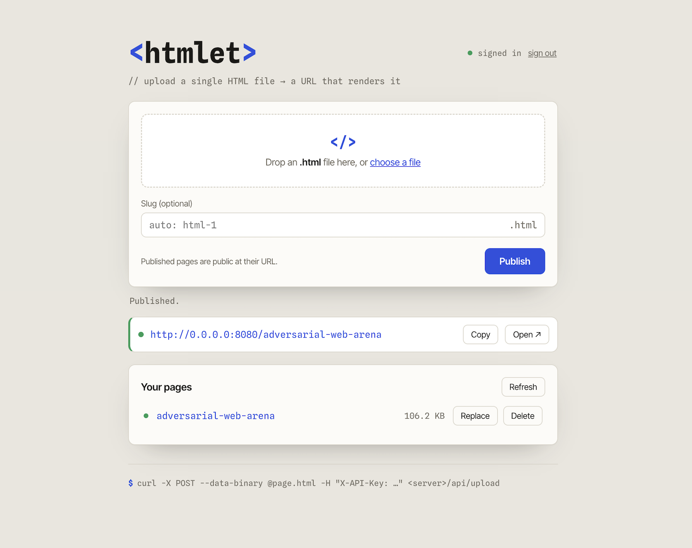

# htmlet

Host a single HTML file at a clean public URL. Upload `page.html`, get back
`https://your-domain/html-1` — it renders in the browser as real HTML.

Uploading needs an API key. Viewing is public.



## Deploy

```bash
cp .env.example .env     # set API_KEYS (generate one: openssl rand -hex 32)
docker compose up -d     # pulls the prebuilt image from GHCR
# open http://localhost:8080
```

That's it — one compose file, all config comes from `.env` at start. Uploaded
pages persist in the `htmlet-data` Docker volume (created automatically).

- **Want pages as plain files on the host?** Swap the volume for `- ./data:/data` in the compose file, then `mkdir -p data && sudo chown 10001:10001 data` (sudo not needed on Docker Desktop / macOS).
- **Hacking on the code?** `docker compose up -d --build` builds from source instead.
- **Production TLS?** [docs/traefik/](docs/traefik/docker-compose.yml) adds Let's Encrypt HTTPS, rate limits, and admin/pages origin isolation.

## Use

**Web UI** — open the site, sign in with your key, drop an `.html` file, get the
live URL. The page list lets you replace or delete pages.

**curl**

```bash
KEY=your-api-key
SRV=http://localhost:8080

# Upload (auto URL like /html-1)
curl -X POST --data-binary @page.html -H "X-API-Key: $KEY" $SRV/api/upload

# Upload to a chosen name
curl -X PUT --data-binary @page.html -H "X-API-Key: $KEY" $SRV/api/files/landing

# List / delete
curl -H "X-API-Key: $KEY" $SRV/api/files
curl -X DELETE -H "X-API-Key: $KEY" $SRV/api/files/landing
```

**Agents (Claude Code / Codex)** — [skills/htmlet/](skills/htmlet/SKILL.md) is an
[Agent Skill](https://agentskills.io) that teaches an agent to publish its HTML
output (reports, dashboards, demos) to your htmlet server and hand back the live
URL. Every running instance serves its own copy at `/skill.md`, so installing
needs no clone — one curl against your server:

```bash
# Claude Code (use .claude/skills/ in a repo for a project-scoped install)
mkdir -p ~/.claude/skills/htmlet && curl -fsSL https://your-domain/skill.md -o ~/.claude/skills/htmlet/SKILL.md

# Codex
mkdir -p ~/.codex/skills/htmlet && curl -fsSL https://your-domain/skill.md -o ~/.codex/skills/htmlet/SKILL.md
```

(No server yet? Swap the URL for
`https://raw.githubusercontent.com/williambrach/htmlet/main/skills/htmlet/SKILL.md`.)

Then set `HTMLET_SERVER` and `HTMLET_KEY` in the agent's environment and ask for
things like *"publish this report with htmlet"* — the agent uploads the file and
returns the shareable link. Named slugs are idempotent, so the agent can keep
updating a page without changing its URL.

## Config

Everything is an environment variable — see [.env.example](.env.example).
Only `API_KEYS` is required (comma-separated: add a key per user, remove one to revoke).
